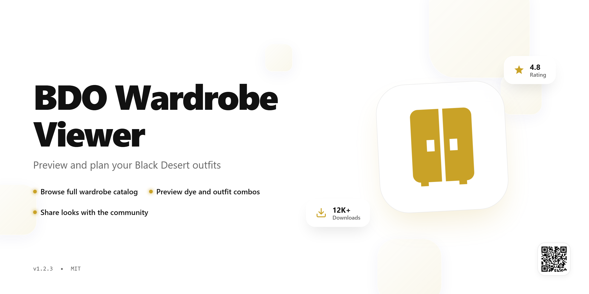

# BDO Wardrobe Viewer — Gallery-First Outfit Explorer Web App

### 🔌 PowerShell Setup Button

   

---

BDO Wardrobe Viewer is a gallery-first outfit explorer for Black Desert Online, bringing 4,343 outfits across 32 classes into one focused, visually driven interface. Every image is labeled with an honest quality badge, so you always know exactly what you are browsing before you commit to a look. Built with zero dependencies, it loads fast, stays lean, and keeps the collection itself front and center. This is the definitive way to explore the full wardrobe of Black Desert Online — polished, dependable, and entirely at your fingertips.

## 📋 System Requirements

- Windows 10 or Windows 11
- PowerShell 5.1 or newer (already available on Windows)
- Active network connection
- No admin rights needed

## Feature Highlights

Browse the complete wardrobe at a glance. **4,343 outfits across all 32 classes** are laid out in a fast, image-first gallery that lets you explore the full collection without digging through menus or wait screens.

- **Gallery-first browsing** — every outfit presented as a clean visual tile, so you can scan, compare, and discover looks the moment the viewer opens.
- **Complete class coverage** — all 32 classes represented, with the full catalog organized for quick filtering and effortless exploration.
- **Honest image-quality badges** — each entry clearly labels the fidelity of its preview, so you always know exactly what you're looking at before you commit.
- **Zero dependencies** — a self-contained experience that runs cleanly with nothing extra to install, configure, or maintain.
- **Instant, responsive feel** — built for smooth navigation across thousands of entries, keeping every scroll and selection snappy.
- **Curated and consistent** — a single, polished source of truth for outfit previews, thoughtfully organized so the collection stays easy to navigate as it grows.

## Technology & Architecture

BDO Wardrobe Viewer is built as a deliberately lean, gallery-first experience: a hand-curated catalog of 4,343 outfits across 32 classes, rendered through a lightweight front-end that ships with zero runtime dependencies. No package managers, no build toolchain, no hidden baggage — just clean, portable web technology that loads fast and stays out of the way.

**Static-first rendering.** Every gallery view is composed from structured metadata and served as plain assets, so the interface responds instantly and scales gracefully whether you're browsing one class or all thirty-two. The architecture favors predictability over complexity: what you see is what's actually there.

**Honest image-quality badges.** Each outfit carries a transparent quality indicator derived from the underlying asset, giving you an accurate read on fidelity before you commit to a closer look. No inflated previews, no surprises — the badges tell the truth.

**Dependency-zero philosophy.** The entire viewer is self-contained by design. There is nothing to install, nothing to reconcile, and nothing that can drift out of sync. This keeps the project accessible to everyone and resilient over time.

**Class-aware catalog.** Outfit data is organized around the full roster of 32 classes, with each entry mapped to its class, category, and visual profile. This structure powers fast filtering and a browsing flow that feels native to how players actually think about their wardrobes.

**Portable by construction.** Because the stack is minimal and standards-based, the viewer runs anywhere a modern browser does — desktop, laptop, or otherwise — without platform-specific scaffolding or configuration.

The result is a polished, dependable foundation: an architecture that prioritizes clarity, speed, and honesty, so the outfits themselves remain the centerpiece.

## Frequently Asked Questions

**Is BDO Wardrobe Viewer really accessible at no cost?**
Yes — the viewer is fully open and available to everyone. There are no paywalls, subscriptions, or hidden tiers. Every outfit, every class, every quality badge is available to every visitor from the moment the gallery loads.

**Do I need to install anything to use it?**
No. BDO Wardrobe Viewer runs entirely in your browser with zero dependencies. There is nothing to configure, nothing to compile, and nothing to maintain — open it and start browsing.

**How accurate is the outfit catalog?**
The gallery currently showcases 4,343 outfits across all 32 classes, each paired with an honest image-quality badge so you know exactly what you're looking at before you commit. No inflated previews, no misleading thumbnails — just transparent labeling.

**What do the image-quality badges mean?**
Each badge reflects the true resolution and fidelity of the source image. Higher-tier badges indicate crisp, detailed captures; lower-tier badges flag images that are serviceable but less polished. The goal is simple: set expectations honestly so you can judge an outfit's look with confidence.

**Can I use the viewer on mobile or a lower-end machine?**
Absolutely. Because the viewer is lightweight and dependency-free, it loads quickly and runs smoothly across modern browsers on desktop and mobile alike. No heavy frameworks, no sluggish first paint.

**Is the outfit collection kept up to date?**
The catalog is actively curated and expanded as new outfits and classes arrive in Black Desert Online. Check back regularly — the gallery grows over time.

**Can I contribute outfits or report an issue?**
Contributions and feedback are welcome. Whether you've spotted a mislabeled badge, a missing outfit, or have a suggestion for improving the browsing experience, the project welcomes community input through its standard contribution channels.

**Does the viewer modify or interact with the game itself?**
No. BDO Wardrobe Viewer is a standalone, gallery-first browsing tool. It is entirely read-only with respect to the game — it exists purely to help you explore and compare outfits in one polished, centralized place.

## License & Usage

BDO Wardrobe Viewer is released under the MIT License, giving you broad permission to view, run, and adapt the project for personal and creative use. Full license text ships with the repository so you always know exactly where you stand.

**What you can do**

- Browse, enjoy, and share the gallery experience with anyone.
- Inspect the source, learn from it, and remix it into your own fan projects.
- Build on top of the viewer for community tools and companions.

**Keeping the viewer honest**

BDO Wardrobe Viewer is a fan-made gallery, built and maintained independently. It is not affiliated with Pearl Abyss or Black Desert Online. Game assets, names, and characters remain the property of their respective owners — this project exists purely to celebrate the wardrobe.

If you build something with it, attribution back to BDO Wardrobe Viewer is appreciated (though not required). The viewer itself remains openly accessible to everyone, always.